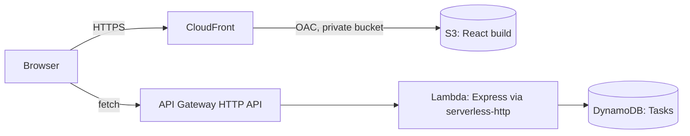

# Task Manager v2 — Serverless on AWS

An admin-dashboard task manager: dashboard metrics, a filterable task table, categories, a slide-in editor and dark mode. Built on a serverless AWS stack defined in a single SAM template.

**Cost: $0 on the AWS free tier** at demo scale (S3, CloudFront, API Gateway, Lambda and on-demand DynamoDB all fit inside their free allowances).

## What's new in v2

- Tasks now have `description`, `priority` (high/medium/low), `dueDate` and `category`.
- New endpoints: `GET /categories`, `GET /stats`; `GET /tasks` accepts filters.
- Strict input validation (400 with a clear message).
- React admin dashboard (no UI libraries; all CSS by hand in `frontend/src/styles.css`), responsive, dark mode persisted in `localStorage`.
- Fixed from v1: DynamoDB `list` read the wrong response field, and updates/deletes now use `attribute_exists(taskId)` so a bad id returns 404 rather than creating an item.

## Architecture



## API

| Route | Body / query | Response |
|---|---|---|
| `GET /tasks` | `?done=true\|false&priority=high\|medium\|low&category=&search=` | filtered task array |
| `POST /tasks` | `{ title, description?, priority?, dueDate?, category? }` | `201` + task |
| `PUT /tasks/:id` | any of the task fields, incl. `done` | `200` + updated task |
| `DELETE /tasks/:id` | | `204` |
| `GET /categories` | | sorted array of unique category strings |
| `GET /stats` | optional `?today=YYYY-MM-DD` | `{ total, done, overdue, high, medium, low }` |

Task: `{ userId, taskId, title, description, done, priority, dueDate (YYYY-MM-DD | null), category, createdAt, updatedAt }`.
Defaults on create: `priority "medium"`, `category "General"`, `description ""`, `dueDate null`, `done false`.
Limits: title 1–200 chars, description ≤ 2000, category 1–50. `search` matches title and description, case-insensitively.
"Overdue" = not done and `dueDate` before today. The UI sends `?today=` so "today" follows the browser's timezone; without it the server uses UTC.

## Run locally (no AWS account needed)

The API uses an in-memory store when `TABLE_NAME` is not set (data resets on restart).

```bash
# terminal 1
cd backend && npm install && npm test && npm run dev    # http://localhost:3001

# terminal 2
cd frontend && npm install && npm run dev               # http://localhost:5173
```

Tests use the built-in `node --test` runner (no extra packages). To point the UI at a different API, copy `frontend/.env.example` to `frontend/.env`.

## Deploy

Prerequisites: AWS CLI v2 and SAM CLI, configured for an IAM admin user (not root).

```bash
sam build
sam deploy --guided           # first time; later just: sam deploy
./scripts/deploy-frontend.sh  # (Windows: scripts/deploy-frontend.ps1) builds React with the API URL, uploads to S3, invalidates CloudFront
```

`samconfig.toml` keeps the v1 stack name (`task-manager-day01`), so deploying v2 **updates the existing stack in place** and keeps its table. Change `stack_name` there (and `STACK` for the scripts) if you want v2 side by side.

## Tear down

```bash
aws s3 rm s3://<SiteBucketName> --recursive   # bucket must be empty first
sam delete
```

## Design notes

- **DynamoDB, on-demand.** Key: `userId` (partition) + time-sortable `taskId` (sort). One paginated `Query` per request; filters run in the Lambda because a personal task list is small and this avoids an index per filter combination. Past a few thousand tasks per user, move filtering into a GSI/`FilterExpression`.
- **Least privilege.** The Lambda role has four DynamoDB actions on one table. The bucket stays private; only this CloudFront distribution can read it (OAC).
- **CORS.** Handled by the HTTP API in AWS (allows the CloudFront domain plus `DevOrigin`); handled by `cors` in `backend/server.js` locally.
- **Fixed user.** Every request belongs to `demo-user` until auth (Cognito) is added.
