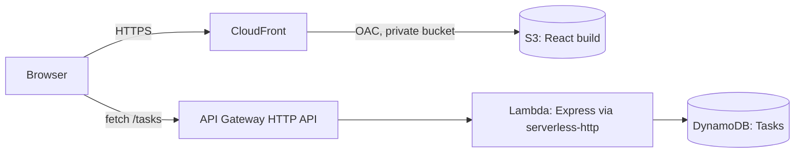

# Task Manager on AWS (Serverless)

A task manager (add, edit, complete, delete, filter) built on a serverless AWS stack and defined entirely in one SAM template. Day 1 of a 20-project AWS portfolio.

**Cost: $0 on the AWS free tier** (S3, CloudFront, API Gateway, Lambda and DynamoDB on-demand all fit inside their free allowances at demo scale).

## Architecture



| Layer | Service | Notes |
|---|---|---|
| Frontend | React (Vite) on S3 + CloudFront | Bucket is private; only this distribution can read it (Origin Access Control) |
| API | API Gateway HTTP API | Throttled (10 req/s, burst 20); CORS allows only the CloudFront domain |
| Compute | Lambda (Node.js 24, arm64) running Express | One role, 4 DynamoDB actions, one table, no `*` resources |
| Data | DynamoDB, on-demand | Partition key `userId`, sort key `taskId` |
| IaC | AWS SAM / CloudFormation | `sam deploy` creates everything, `sam delete` removes it |

## Project layout

```
backend/    Express app (app.js), DynamoDB access (db.js), Lambda entry (lambda.js), local server (server.js)
frontend/   React + Vite app
scripts/    deploy-frontend.sh (build, upload to S3, invalidate CloudFront)
template.yaml, samconfig.toml
```

## Run locally

No AWS account needed. The API uses an in-memory store when `TABLE_NAME` is not set.

```bash
# terminal 1
cd backend && npm install && npm run dev      # http://localhost:3001

# terminal 2
cd frontend && npm install && npm run dev     # http://localhost:5173
```

Run the API tests with `cd backend && npm test`.

## Deploy

Prerequisites: AWS CLI v2 and SAM CLI configured for an admin IAM user (not root), region `ap-south-1`.

```bash
sam build
sam deploy --guided          # first time; later just: sam deploy
./scripts/deploy-frontend.sh # builds React with the API URL, uploads to S3, invalidates CloudFront
```

The script prints the live CloudFront URL. Resources are tagged `project=day01`, so Cost Explorer can show what this project costs.

## Tear down

```bash
aws s3 rm s3://<SiteBucketName> --recursive   # bucket must be empty first
sam delete
```

## Design decisions

- **DynamoDB, not MongoDB.** Lambda cannot keep a connection pool between requests, and DynamoDB is accessed over HTTPS with IAM, so there is nothing to hold open.
- **Time-sortable `taskId`.** A single `Query` on `userId` returns tasks in creation order, with no scan and no sort step.
- **Conditional writes.** `UpdateItem` and `DeleteItem` use `attribute_exists(taskId)`, so a bad id returns 404 instead of silently creating an item.
- **On-demand capacity.** Unpredictable traffic and no capacity planning. Provisioned capacity wins only when load is steady and predictable.
- **OAC instead of a public bucket.** CloudFront is the only way in, so HTTPS and caching are enforced.
- **Execution role vs resource policy.** The Lambda *role* grants it DynamoDB access; the *bucket policy* grants CloudFront access to S3.

## Next

Day 3 replaces the fixed `userId` with a Cognito user pool and a JWT authorizer.
